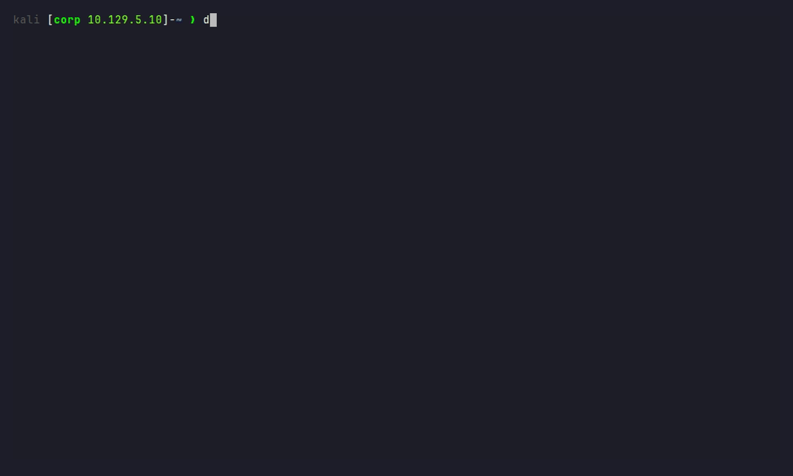

# Commands

[README](../README.md) · **Commands** · [Notes](notes.md) · [Config](config.md) · [Development](development.md)

Everything runs through `dz`. Without options it opens the menu; with options it runs the action straight away.

- [Overview](#overview)
- [New box](#new-box)
- [Change IP](#change-ip)
- [Load, view, info, unload](#load-view-info-unload)
- [Done, archive, open note](#done-archive-open-note)
- [Flags, timeline, screenshots](#flags-timeline-screenshots)
- [Creds](#creds)
- [Remove](#remove)
- [Menu](#menu)
- [Variables](#variables)
- [Config](#config)

## Overview

| Option | Does |
|---|---|
| `-n <name>` | new box (needs `-ip`) |
| `-ip <ip>` | target IP; without `-n` it changes the IP |
| `-h <host,...>` | hostnames, added to `/etc/hosts`; without `-n` it changes them, `none` clears them |
| `-l <name>` | load a box |
| `-v` | view all boxes, `--all` includes the archive |
| `-i` | show the loaded box |
| `-x` | unload the box |
| `-o [name]` | open the note (editor, or Obsidian with `notes = vault`) |
| `-d [name]` | mark a box done |
| `-a <name>` | archive a box |
| `-f [user\|root] [flag]` | store a flag in the note (root flag = done), or show the flags |
| `-j [text]` | add a line to the note's timeline, or show it |
| `-s [caption]` | screenshot to `evidence/`, embedded in the timeline |
| `-c [user[:secret]] [source]` | store or list creds, opt-in (`creds = yes`) |
| `-r <name>` | remove a box |
| `-y` | no confirmation (with `-r`) |
| `--note` | also trash the note (with `-r`) |
| `--keep-note` | keep the note (with `-r`) |
| `--config` | edit the config, applies after saving |
| `--config show` | values in use now |
| `--config check` | settings you don't have yet, after an update |
| `--update` | update dropzone; config, templates, boxes and notes stay |
| `--version` | version |
| `-h`, `--help` | help (`-h` without a value, `--help` anywhere) |

One action per call: `-n`, `-l`, `-v`, `-i`, `-x`, `-o`, `-d`, `-a`, `-f`, `-j`, `-s`, `-c` or `-r`. Tab completion knows every option and fills in box names after `-l`, `-r`, `-o`, `-d` and `-a` (archived ones too after `-l`, `-o` and `-d`).

## New box

```bash
dz -n <name> -ip <ip> [-h <host,...>]
```

| Example | Does |
|---|---|
| `dz -n jacops -ip 10.129.42.190` | folder, note and variables |
| `dz -n jacops -ip 10.129.42.190 -h jacops.htb` | also adds a line to `/etc/hosts` (asks for sudo) |
| `dz -n jacops -ip 10.129.42.190 -h dc01.jacops.htb,jacops.htb` | several hostnames on one line; `$DOMAIN` is the first |

What it sets up:

- `~/boxes/<name>/` with the folders from the config (default `scans/`, `loot/`, `exploits/`, `evidence/`, `logs/`), and `cd`s into it
- `~/boxes/<name>/.dropzone` with name, IP and hostnames. dz reads it line by line and never runs it, so files from a target (a dumped `.env`, unpacked loot) can't run code on your Kali
- a note from your template: `~/boxes/<name>/notes.md`, or `<vault>/Boxes/<name>.md` with `notes = vault`, see [notes.md](notes.md)
- an `/etc/hosts` line tagged `# dz:<name>`, after a backup to `/etc/hosts.dz.bak`
- one ping to the target, info only (`ping = no` in the config turns it off)

`dz -n` on a box that already exists updates its IP and keeps its hostnames, unless you give new ones.

## Change IP

```bash
dz -ip <ip>               # loaded box
dz -l <name> -ip <ip>     # another box
dz -h <host,...>          # only the hostnames of the loaded box
dz -h none                # remove its /etc/hosts line
```

- The old IP is replaced by the new one everywhere in the note, and `updated:` is set to today.
- Matching is exact: `10.10.10.1` leaves `10.10.10.15` alone.
- The `/etc/hosts` line for that box moves along. Add `-h <host,...>` to change the hostnames too.
- The note is never overwritten.

## Load, view, info, unload

| Command | Does |
|---|---|
| `dz -l jacops` | load a box and `cd` into its folder |
| `dz -v` | view all boxes with IP, status and hostnames, `▶` marks the loaded one |
| `dz -v --all` | also the archived boxes |
| `dz -i` | box, target, hostnames, attacker IP, status, folder and note of the loaded box |
| `dz -x` | unload the box |

New terminals load the last box automatically. `$ATTACKER_IP` is read again before the prompt (at most every 10 seconds), so it follows a VPN reconnect.

## Done, archive, open note

| Command | Does |
|---|---|
| `dz -d` / `dz -d jacops` | mark the loaded box (or `jacops`) done: `status: done` and `updated:` in the note |
| `dz -a jacops` | done, plus the folder moves to `~/boxes/_archive/jacops` and its `/etc/hosts` line goes; the note stays |
| `dz -l jacops` | on an archived box: moves it back and sets `status: active` |
| `dz -o` / `dz -o jacops` | open the note: in `$VISUAL` / `$EDITOR` or the desktop's default app; with `notes = vault` in Obsidian (`obsidian://` link). Without either it prints the path or link |

The status lives in the note's frontmatter (`status: active` / `status: done`), so Obsidian sees it too. `dz -v` reads it from there; `bezig` / `af` from older notes read as `active` / `done`.

## Flags, timeline, screenshots

All three write into the note of the loaded box, so your report grows while you work.

| Command | Does |
|---|---|
| `dz -f 3f9a...e1` | flag into the first empty slot under `## Flags` (user, then root) |
| `dz -f root 3f9a...e1` | into the root slot |
| `dz -f` | show the user and root flag |
| `dz -j found an NFS share with backups` | `- 2026-10-14 15:32 · found an NFS share with backups` in the timeline |
| `dz -j` | the last 10 timeline entries |
| `dz -s` / `dz -s smb share listing` | select a region; the PNG goes to `evidence/` and is embedded in the timeline |

- **Flags**: `- **User flag:**` lines (the bundled template) or Obsidian callouts (see [examples/obsidian](../examples/obsidian/)). A filled slot is never overwritten. A flag that isn't 32 hex gets a warning and is stored anyway. Every flag adds a timeline line, and the **root flag marks the box done**. A note without a `## Flags` section gets one.
- **Timeline**: a section `## Timeline` (config `timeline`), added right before `## Flags` when the note doesn't have it. `-j` takes the rest of the line, quotes are optional.
- **Screenshots**: saved as `evidence/<box>_<date>_<time>_<caption>.png` and embedded as ``. With `notes = vault` a copy goes to `Boxes/attachments/<box>/` (config `attachments`), because Obsidian only shows images inside the vault. With `notes = off` the screenshot is only saved. The tool is `xfce4-screenshooter`, `flameshot`, `gnome-screenshot` or `import`, the first one found (config `screenshot`). Needs a desktop session; Esc cancels.
- A hotkey for screenshots: in Xfce, *Settings → Keyboard → Application Shortcuts*, command `zsh -ic 'dz -s'`. New shells load the last box, so it lands in the right note.

## Creds

Off by default. Turn it on with `creds = yes` in the config (`dz --config`).

| Command | Does |
|---|---|
| `dz -c alex NFS` | store a cred for the loaded box, with where you found it, and make it active; asks for the secret without echo |
| `dz -c 'alex:lol123!mD' NFS` | same, with the secret on the command line |
| `dz -c 'admin:31d6cfe0d16ae931b73c59d7e0c089c0'` | 32 hex characters (or `LM:NT`) is stored as an NT hash |
| `dz -c` | list the creds of the loaded box, `▶` marks the active one |
| `dz -c 2` | make cred #2 active |

- The active cred sets `$TARGET_USER` and either `$PASSWORD` or `$NT_HASH`. `$USER` is left alone, because that is your own login.
- Creds live in `~/boxes/<name>/creds` (only readable by you) and get a row in the *Credentials & secrets* table of the note.
- Everything after the first `:` is the secret, so passwords with `:` work. Quote secrets with `!` or spaces.
- `dz -c ...` and `dz --creds ...` are logged as `dz -c <hidden>` in `commands.log`. A secret on the command line is still in your zsh history; `dz -c <user>` keeps it out, or start the command with a space.
- Creds are plain text in the `creds` file, in the note and, after `dz -r`, in the trash. Fine for lab creds; know where your vault syncs to.

## Remove

```bash
dz -r <name> [-y] [--note | --keep-note]
```

| Example | Does |
|---|---|
| `dz -r jacops` | asks to confirm, then asks about the note (needs a terminal, otherwise add `-y`) |
| `dz -r jacops --note` | the note goes too |
| `dz -r jacops -y --keep-note` | no questions, the note stays |

| What | Where to |
|---|---|
| `~/boxes/<name>/` | system trash (`gio trash`), deleted if there is no trash |
| the note | `notes = folder`: along with the folder · `notes = vault`: `.trash/` in the vault, only if you choose so |
| `/etc/hosts` line | removed |
| loaded box | unloaded |

Only folders made by dropzone can be removed. Names must start with a letter or digit, so `.` and `..` are never a box.

## Menu

```bash
dz             # open the menu
DZ_ART=7 dz    # with a fixed banner art (1-10), just this once
```

<p align="center"></p>

| Item | Does |
|---|---|
| New box | form for name, IP and hostnames |
| Load box | pick a box from the list, archived ones included |
| Change IP | new IP for the loaded box, old IP prefilled |
| Open note | open the note of the loaded box in Obsidian |
| Mark done | mark the loaded box done, optionally archive it |
| Remove box | pick a box, confirm, choose whether the note goes too |
| Unload box | unload the box |
| Quit | close the menu |

*Change IP*, *Open note*, *Mark done* and *Unload box* are greyed out when no box is loaded. A box list longer than the screen scrolls.

| Key | Action |
|---|---|
| `↑` `↓` | move |
| `Enter` / `Space` | open |
| `1` – `9` | jump straight to an item |
| `q` / `Esc` | back, or close |
| `←` `→` / `Tab` | switch Yes / No |
| `y` / `n` | yes / no straight away |

Yes/no questions default to *No*. An empty name or IP field cancels the form.

## Variables

Set when a box is loaded:

| Variable | Value |
|---|---|
| `$BOX` | box name |
| `$TARGET_IP` | target IP |
| `$DOMAIN` | first hostname, if given |
| `$TARGET` | same as `$TARGET_IP` |
| `$ATTACKER_IP` | current IP of `iface` from the config (default `tun0`) |
| `$INTERFACE` | `iface` from the config |
| `$TARGET_USER` | active cred, with `creds = yes` |
| `$PASSWORD` / `$NT_HASH` | secret of the active cred |

`$TARGET`, `$DOMAIN`, `$ATTACKER_IP`, `$INTERFACE`, `$PASSWORD` and `$NT_HASH` match the names used by [The Hacker Recipes](https://thehacker.recipes/contributing/variables) and Exegol, so their commands paste straight in.

## Config

See **[config.md](config.md)** for every setting. Short version:

```bash
dz --config         # edit, applies after saving
dz --config show    # values in use now
```
