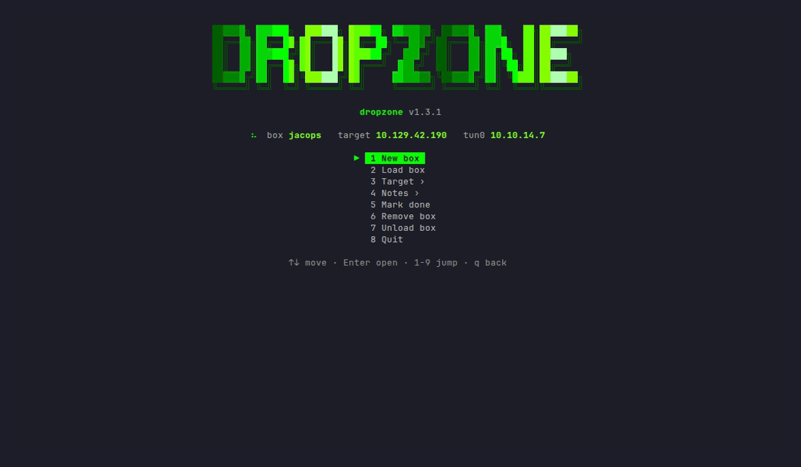

# Commands

[README](../README.md) · [Guide](guide.md) · **Commands** · [Notes](notes.md) · [Config](config.md) · [Errors](errors.md) · [Testing](testing.md) · [Development](development.md)

Everything runs through `dz`. Without options it opens the [menu](#menu), with options it runs one action straight away. New to dz? Start with the [guide](guide.md). An error shows a code like `dz [E201] no box loaded`; `dz --explain E201` or [errors.md](errors.md) says why.

- [Overview](#overview)
- **Boxes**: [New box](#new-box) · [Change IP](#change-ip) · [Load, view, info](#load-view-info) · [Done, archive, remove](#done-archive-remove)
- **Hosts**: [More hosts in a box](#more-hosts-in-a-box) · [Hosts behind a pivot](#hosts-behind-a-pivot)
- **Notes**: [Timeline](#timeline) · [Flags](#flags) · [Screenshots and output](#screenshots-and-output) · [To-dos](#to-dos) · [Findings](#findings) · [Search](#search)
- **More**: [Creds](#creds) · [Ports from nmap](#ports-from-nmap) · [Serve files](#serve-files) · [Clipboard](#clipboard) · [Deadline](#deadline) · [SysReptor](#sysreptor)
- **Reference**: [Menu](#menu) · [VPN check](#vpn-check) · [Variables](#variables) · [Config and update](#config-and-update)

## Overview

| Option | Does |
|---|---|
| `-n <name> -ip <ip> [-h <host,...>]` | new box; `--template <name>` picks another note template, `--deadline <when>` sets a time limit |
| `-ip <ip>` / `-h <host,...>` | new IP or hostnames for the loaded box (`-l <name> -ip ...` for another one) |
| `-l <name>` | load a box (an archived one comes back) |
| `-v [--all]` | all boxes with status, `--all` with the archive |
| `-i [host]` | the loaded box and what's next, or everything about one host |
| `-x` | unload the box |
| `-d [name]` / `-a <name>` / `-r <name>` | mark done / archive / remove (to the trash) |
| `-t [host]` | list the hosts, or make `<host>` the target |
| `-t <host> -ip <ip> [-h ...] [--via <pivot>]` | add or change a host; `--drop` removes it |
| `-o [name]` | open the note |
| `-j [text]` | line in the timeline, or show it |
| `-f [user\|root\|<host>] [flag]` | store a flag, or show them |
| `-s [caption]` | screenshot to `evidence/`, into the note |
| `<cmd> \| dz -e [caption]` | command output to `evidence/`, into the note |
| `--todo [text]` | add a to-do, or list them; `--todo done <nr>` ticks one off |
| `--finding [title\|nr\|off\|done]` | start, list, switch, stop or close a finding |
| `-g <term> [--all]` | search the notes of every box |
| `-c [user[:secret]] [source]` | store or list creds (needs `creds = yes`); `--valid <hosts>`, `--export` |
| `-p [file]` | open ports from your nmap output into the note |
| `serve [smb] [dir] [port] [--via <host>]` | file server with download commands |
| `-cp [what]` | copy an IP or a cred to the clipboard |
| `--deadline [when]` | time limit of the loaded box |
| `--config [show\|check]`, `--update`, `--explain [code]`, `--version`, `--help` | setup |

**One action per call.** `dz -l jacops -i` is refused (`E103`); options that only change how an action works (`-ip`, `-h`, `--via`, `--template`, `--deadline`, `--all`, `-y`) can go along. `-j`, `-s`, `-e`, `--todo` and `--finding` take the rest of the line as text, quotes optional. `--help` works anywhere except inside that text. Tab completion knows every option, box names, host names and the choices.

## Boxes

### New box

```bash
dz -n jacops -ip 10.129.42.190 -h jacops.htb
```

- `~/boxes/jacops/` with the folders from the config (`scans/ loot/ exploits/ evidence/ logs/`), and you `cd` into it.
- `~/boxes/jacops/.dropzone` with name, IP and hostnames. dz reads it, never runs it, so loot in the folder can't run code on your Kali.
- A note from your template ([notes.md](notes.md)).
- An `/etc/hosts` line tagged `# dz:jacops` (sudo, backup in `/etc/hosts.dz.bak`). More hostnames: `-h dc01.jacops.htb,jacops.htb`; `$DOMAIN` is the first.
- One ping (`ping = no` turns it off) and the [VPN check](#vpn-check).

`--template box-note-extended` uses the note with all 8 PTES phases. `--template exam` uses the exam note: Scope, Hosts with a *Via* column, Findings table, Host notes and flags per host. dz looks for `exam.md`, `exam-note.md` or `Exam-note.md` in `~/.config/dropzone/templates/`, next to your own `template`, then in dropzone's `templates/`. A name with `/` or `.md` is a path. The template only counts for a **new** box: an existing note is never replaced, and `dz -n` on an existing box only updates its IP.

### Change IP

```bash
dz -ip 10.129.42.201          # loaded box
dz -l jacops -ip 10.129.42.201  # another box
dz -h dc01.jacops.htb          # only the hostnames; -h none removes the hosts line
```

The IP changes in the variables, the hosts line and everywhere in the note (exact match: `10.10.10.1` leaves `10.10.10.15` alone).

### Load, view, info

| Command | Does |
|---|---|
| `dz -l jacops` | load it and `cd` into its folder |
| `dz -v` / `dz -v --all` | every box with IP, status and hostnames, `▶` = loaded; `--all` with the archive |
| `dz -i` | target, attacker IP, folder, note, active cred, deadline, the hosts, and **Next**: open to-dos, the active finding and the last 3 timeline lines |
| `dz -i dc01` | one host: IP, `$DC01_IP`, hostnames, pivot, flags, its to-dos and findings, and the creds that work there (user and number, never the secret) |
| `dz -x` | unload |

New terminals load the last box (`autoload = yes`). `$ATTACKER_IP` is read again before the prompt, at most every 10 seconds.

### Done, archive, remove

| Command | Does |
|---|---|
| `dz -d [name]` | `status: done` in the note's frontmatter |
| `dz -a jacops` | done, and the folder moves to `~/boxes/_archive/`; its hosts lines go, the note stays. `dz -l jacops` brings it back |
| `dz -r jacops` | folder to the system trash after a question; asks about a vault note too. `-y` skips the questions, `--note` / `--keep-note` decide about the note. Works on archived boxes |

`dz -o [name]` opens the note: `$VISUAL` / `$EDITOR`, the desktop's default app, or Obsidian with `notes = vault`. Without either it prints the path or `obsidian://` link.

## Hosts

### More hosts in a box

<p align="center"></p>

For an AD set or a lab: the box keeps its own IP (the main host), you add the others by name.

```bash
dz -t dc01 -ip 10.10.10.5 -h dc01.corp.local   # add a host: $DC01_IP
dz -t                                          # list, ▶ = target
dz -t dc01                                     # dc01 becomes the target
dz -t corp                                     # back to the main host (the box name)
dz -t dc01 -ip 10.10.10.15                     # new IP, hostnames stay
dz -t dc01 --drop                              # remove it
```

- `$DC01_IP`: the name in capitals, `-` becomes `_`. `$TARGETS` holds every IP, so `nxc smb $TARGETS` hits them all.
- `$TARGET_IP`, `$TARGET` and `$DOMAIN` follow the target; the prompt shows it: `[corp dc01 10.10.10.5]-`.
- Each host gets a hosts line (`# dz:<box>/<host>`), a row in the note's Hosts table, a `### <host>` heading under `## Host notes` (exam template) and a timeline line.
- Names: lowercase letters, digits and `-`. `dz -ip` and `dz -h` without `-t` always change the main host.

### Hosts behind a pivot

```bash
dz -t web01 -ip 172.16.5.15              # the pivot, its internal IP
dz -t ms01 -ip 172.16.5.10 --via web01   # ms01 sits behind web01
dz -t ms01 --via none                    # no pivot
```

`dz -t` and `dz -i` show `via web01`, and the *Via* column in the note is filled. `--via` never changes the target. Dropping a pivot clears it on the hosts behind it. Stored in `~/boxes/<box>/.via`.

## Notes

Everything here writes into the note of the loaded box. Where exactly: [notes.md](notes.md#what-dropzone-writes-into-the-note).

### Timeline

```bash
dz -j found an NFS share with backups   # - 2026-10-14 15:32 · found an NFS share with backups
dz -j                                   # the last 10 lines
```

The section is `## Timeline` (config `timeline`). Flags, hosts, ports, deadlines, findings and evidence add their own timeline lines.

### Flags

| Command | Does |
|---|---|
| `dz -f 3f9a...e1` | into the first empty slot: user, then root. **The root flag marks the box done** |
| `dz -f root 3f9a...e1` | into the root slot |
| `dz -f dc01 3f9a...e1` | the flag of a host; on a box with more hosts `dz -f <flag>` uses the active host |
| `dz -f` | show them, with a count against `flag_goal` (`9/14 flags`) |

A single box has user and root slots (`- **User flag:**` lines or Obsidian callouts). A box with more hosts, or a note without slots like the exam template, keeps a list `- <date> <time> · dc01 · <flag>` and is never marked done by a flag: use `dz -d`. A filled slot or a double flag is refused; a flag that isn't 32 hex gets a warning and is stored anyway.

### Screenshots and output

```bash
dz -s smb share listing                          # select a region
nxc smb $TARGETS 2>&1 | dz -e smb signing off    # pipe a command's output
```

- **`dz -s`**: `evidence/<box>_<date>_<time>_<caption>.png`, embedded in the note. With `notes = vault` a copy goes to `<vault>/Boxes/attachments/<box>/`, because Obsidian only shows images inside the vault. Tool (`screenshot`): on X11 `xfce4-screenshooter`, `flameshot`, `gnome-screenshot`, `spectacle` or `import`; on Wayland `grim` + `slurp`, `spectacle`, `gnome-screenshot` or `flameshot`. Esc cancels. A hotkey: bind `zsh -ic 'dz -s'`.
- **`dz -e`**: `evidence/<box>_<date>_<time>_<caption>.txt` with the command on top (from `commands.log`), colours stripped; the first 30 lines go into the note as a code block. Only stdout is piped: add `2>&1`. To see it too: `| tee /dev/tty | dz -e ...`.
- Both go into the timeline, or **under the active [finding](#findings)**. With `notes = off` they're only saved.

### To-dos

Your own list of what to try next, per host. dz never fills it: what's next is your call.

```bash
dz --todo try the backup creds on winrm   # - [ ] dc01 · try the backup creds on winrm
dz --todo                                 # the open ones, numbered
dz --todo done 2                          # - [x], plus a timeline line
dz --todo --all                           # the done ones too
```

- The to-dos live in `## To do` in the note (added before the timeline when it's missing). In a box with more hosts each one is tagged with the active host.
- The note is the list: tick one off in Obsidian, edit or delete it by hand, dz reads it fresh every time. Numbers are the place in the list, so they don't shift when you tick items off.
- `dz --todo` shows them as a block like `dz -i`; `dz -i` shows the open ones too, `dz -i dc01` those of dc01.
- One word that starts with `-` is refused (`E421`): `dz --todo -s` is a typo, not a to-do.

### Findings

Group evidence per finding while you work, so the report writes itself later.

```bash
dz --finding SMB signing disabled   # F1 on the active host, now active
dz -s relay setup                   # goes under F1
nxc smb $TARGETS | dz -e signing    # under F1 too
dz --finding                        # list: ▶ = active, host, status, evidence count
dz --finding 2                      # make F2 active (a done one opens again)
dz --finding off                    # evidence goes to the timeline again
dz --finding done                   # close the active one (or: done 2)
```

In the note each finding is a heading with a status line, and its evidence below it:

```markdown
## Findings

### F1 · SMB signing disabled

**Host:** dc01 · **Status:** open

- 2026-10-21 14:05 · screenshot: relay setup
  ![[Boxes/attachments/cpts/cpts_2026-10-21_140512_relay-setup.png]]
```

- The timeline gets a short line that points to it: `screenshot: relay setup → F1`.
- A table under `## Findings` (the exam template) gets a row: `#`, `Finding`, `Host`, `Evidence` (counted, unless you put your own text there) and `Status` are found by name. Severity and the rest are yours.
- `dz --finding -s` is refused (`E421`): one action per call, so start the finding and then take the screenshot.
- Removed a finding's heading by hand? dz warns (`W404`) and evidence goes to the timeline. A number is never reused. The active one is in `~/boxes/<box>/.finding`.

### Search

```bash
dz -g kerberoast          # every line with the term, any case, in the notes of all boxes
dz -g 'smb signing' --all # quote spaces; --all includes the archive
```

```
[+] jacops  2
       41  - 2026-10-14 15:02 · kerberoast svc_sql, cracked with rockyou
       57  | svc_sql | kerberoast | ...
• 2 lines in 1 of 6 boxes
```

## More

### Creds

Off by default: `creds = yes` in the config. They are stored in plain text, so only for lab creds.

| Command | Does |
|---|---|
| `dz -c alex NFS` | store a cred and where you found it; asks for the secret without echo |
| `dz -c 'alex:lol123!mD' NFS` | the same, secret on the command line (single quotes for `!`) |
| `dz -c 'admin:31d6cfe0d16ae931b73c59d7e0c089c0'` | 32 hex (or `LM:NT`) is an NT hash |
| `dz -c 'root:loot/id_rsa'` / `dz -c 'adm:loot/adm.ccache'` | a key sets `$SSH_KEY`, a ticket `$KRB5CCNAME` |
| `dz -c` | list them, `▶` = active, `→ dc01` = where it works |
| `dz -c 2` | make #2 active |
| `dz -c 2 --valid dc01,ms01` | where it works (also while storing); fills *Valid on* in the note |
| `dz -c --export` | every user, password and NT hash to `loot/users.txt`, `passwords.txt`, `hashes.txt` |

- The active cred sets `$TARGET_USER` and `$PASSWORD` or `$NT_HASH`. `corp\svc_sql` or `jdoe@corp.local` also sets `$CRED_DOMAIN`. `$USER` stays yours.
- Stored in `~/boxes/<box>/creds` (chmod 600) and as a row in the note's Credentials table.
- `dz -c` is logged as `dz -c <hidden>`, but a secret on the command line is in your zsh history: use `dz -c <user>` or start the line with a space.

### Ports from nmap

dz never scans. You run nmap, `dz -p` reads it:

```bash
nmap -p- -oA scans/all $TARGET_IP
dz -p                      # the newest .xml or .gnmap in scans/
dz -p scans/udp.gnmap      # a given file
```

Every open port becomes a row in the first table under `## Ports` (columns found by name). Rows that are there stay, so a second scan only adds new ports. IPs are matched to the hosts of the box, other IPs are skipped.

### Serve files

```bash
dz serve                       # current folder, port 80
dz serve ~/tools 8000          # a folder and a port
dz serve smb ~/tools           # SMB share (impacket-smbserver)
dz serve ~/tools --via web01   # for a host behind a pivot
```

It prints the download commands with your `$ATTACKER_IP` (`wget`, `iwr`, `copy \\...`), then starts the server; Ctrl-C stops it. With `--via` it prints the ligolo-ng `listener_add` line for the pivot and uses the pivot's IP, on port 8000 (`serve smb --via` is refused: SMB needs port 445 on the pivot).

It binds to your VPN IP only. It refuses a box folder, your boxes folder, the archive, a folder above them and your home folder, and warns (`W604`) when a folder has the `dz -c --export` lists. Needs `python3`, and `impacket-smbserver` for SMB.

### Clipboard

```bash
dz -cp            # target IP          dz -cp me     # your VPN IP
dz -cp dc01       # a host's IP        dz -cp pass   # active password, not shown
```

Also `domain`, `targets`, `user` and `hash`. Uses `wl-copy`, `xclip` or `xsel`; without a desktop it prints the value, so `$(dz -cp dc01)` works.

### Deadline

| Command | Does |
|---|---|
| `dz --deadline 10d` | starts now: `10d`, `48h`, `9d12h` |
| `dz --deadline 2026-12-10T14:00` | until a date and time; a date alone is 23:59 |
| `dz --deadline` | `cpts: day 4/10 · 5d22h left (until 2026-12-10 14:00)` |
| `dz --deadline none` | remove it |

`dz -i` and the prompt show what's left: `[cpts 10.129.5.10 5d22h]-`, red in the last 6 hours. Stored in `~/boxes/<box>/.deadline`.

### SysReptor

With `sysreptor = yes`, `dz -s` and `dz -e` also upload to your [SysReptor](https://docs.sysreptor.com/) project, as notes under a note named after the box; `dz -e` output under an active finding gets its number in the title (`F1 · smb signing`). Needs [reptor](https://github.com/Syslifters/reptor): `pip install reptor`, then `reptor conf`. It runs in the background and logs to `logs/sysreptor.log`. dz only sends evidence; findings and the report stay your work in SysReptor. Secrets on a screenshot go along.

## Reference

### Menu

<p align="center"></p>

`dz` opens it. The banner picks one of 10 arts each time (`art` in the config, or `DZ_ART=7 dz` once):

<p align="center"></p>

| Main menu | | Target › | | Notes › | |
|---|---|---|---|---|---|
| New box | form | Change IP | `dz -ip` | Open note | `dz -o` |
| Load box | list, archive too | Switch host | `dz -t <host>` | Timeline entry | `dz -j` |
| Target › | submenu | Add host | `dz -t <host> -ip` | Add flag | `dz -f` |
| Notes › | submenu | Deadline | `dz --deadline` | To do | `dz --todo` |
| Mark done | optionally archive | | | Finding | `dz --finding` |
| Remove box | confirm, note too? | | | Creds | `dz -c <user>`, secret hidden |
| Unload box | | | | | |
| Quit | | | | | |

The status line shows the box, the target, the time left and your VPN IP. Items that can't work are grey (no box loaded, one host only, `notes = off`, `creds = no`).

**The menu stays open** until you quit (`q` or *Quit* in the main menu). After a to-do, finding, flag, timeline line, deadline, host switch or *Mark done*, you're back where you were and what dz said shows under the menu, so you can add the next one straight away. Actions that may need your terminal (a new box, IP or host with `/etc/hosts` and sudo, loading a box, opening or removing a note, archiving) show their output on the normal screen first; Enter brings the menu back, `q` quits.

Keys: `↑` `↓` move, `Enter` opens, `1`-`9` jump (and open), `q` / `Esc` back. In a form, Enter on an empty field goes back to the menu. Yes/no: `←` `→` or `y` / `n`, default *No*.

### VPN check

On `-n`, `-l`, `-ip` and `-t`, dz checks your VPN and warns, it never stops the command:

| Warning | Means |
|---|---|
| `• [W201] tun0 doesn't exist, is your VPN connected?` | the `iface` interface is down |
| `• [W202] the route to 10.10.10.77 goes through eth0, not tun0` | the target isn't reached over the VPN (wrong IP?) |

A route through a pivot interface (`pivot`, default `ligolo*`) is fine. `vpncheck = no` turns it off. Needs `ip` (iproute2).

### Variables

| Variable | Value |
|---|---|
| `$BOX` | box name |
| `$TARGET_IP`, `$TARGET` | the target: the main host, or the active host from `dz -t` |
| `$DOMAIN` | its first hostname |
| `$DC01_IP`, ... | every extra host |
| `$TARGETS` | every IP of the box, space separated |
| `$DZ_ACTIVE` | the active extra host, empty for the main host |
| `$ATTACKER_IP`, `$INTERFACE` | your VPN IP and interface (`iface`) |
| `$TARGET_USER`, `$PASSWORD` / `$NT_HASH`, `$CRED_DOMAIN`, `$SSH_KEY`, `$KRB5CCNAME` | the active cred |

`$TARGET`, `$DOMAIN`, `$ATTACKER_IP`, `$INTERFACE`, `$PASSWORD` and `$NT_HASH` match [The Hacker Recipes](https://thehacker.recipes/contributing/variables) and Exegol, so their commands paste straight in.

### Config and update

```bash
dz --config          # edit; applies after saving
dz --config show     # what's in use
dz --config check    # settings you don't have yet, and old forms that still work
dz --update          # git pull --ff-only, shows what changed
```

Every setting: [config.md](config.md). `dz --update` never touches your config, templates, boxes or notes; run `exec zsh` after it. It refuses when dropzone's own folder has local changes (`E702`), isn't a git clone (`E701`) or can't fast-forward (`E703`).
